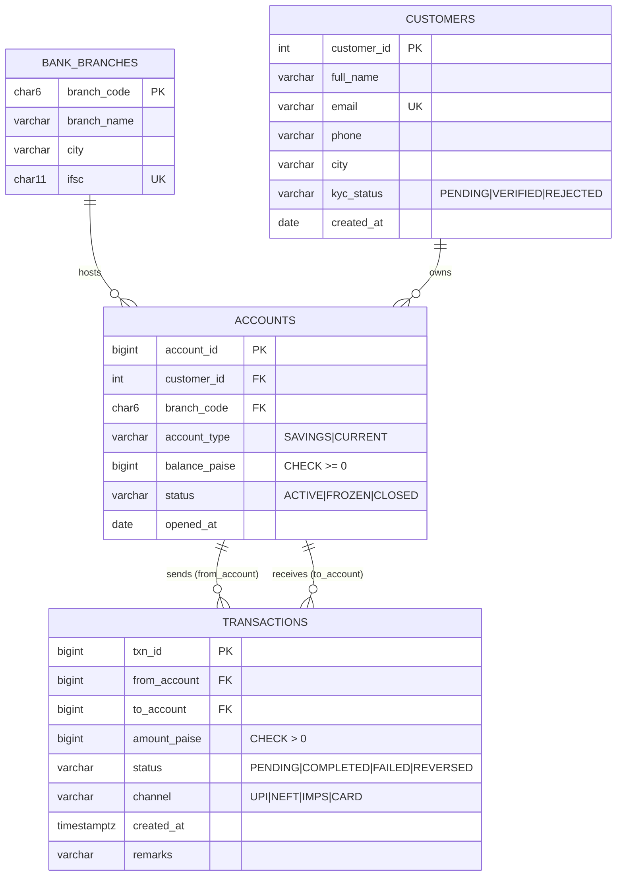

# Database Design — ZK-TemporalDB

This document explains *what* each database stores, *why* that database was chosen,
and which DBMS concepts are demonstrated. It is the starting point for the project report.

| Database | Role | Concepts shown |
|---|---|---|
| **PostgreSQL 16** | Live bank data (`bank` schema) + version-control metadata (`vcs` schema) | ER modelling, 3NF, PK/FK/UNIQUE/CHECK constraints, indexes, triggers, stored procedures/functions, views, recursive CTEs, window functions, ACID transactions, row locking |
| **MongoDB 7** | Live KYC documents + content-addressed snapshot store (blobs, trees, proofs) | Schema-less documents, nested documents, content addressing (Git-style), bulk upserts, deduplication |
| **Neo4j 5** | Commit DAG, record lineage, proof graph | Property graph model, uniqueness constraints, graph traversal, Cypher pattern matching |

---

## 1. PostgreSQL — ER diagram



```mermaid
erDiagram
    BRANCHES ||--o| COMMITS : "head_commit"
    BRANCHES ||--o{ COMMITS : "branch_name"
    HEAD     }o--|| BRANCHES : "checked out"
    COMMITS  ||--o{ COMMIT_PARENTS : "child"
    COMMITS  ||--o{ COMMIT_PARENTS : "parent"
    COMMITS  ||--|| ANCHORS : "anchored by"
    COMMITS  ||--o{ VERIFICATION_RUNS : "checked by"

    COMMITS {
        char16 commit_id PK
        varchar branch_name FK
        numeric merkle_root "Poseidon root"
        varchar message
        varchar author
        int record_count
        timestamptz created_at
    }
    COMMIT_PARENTS {
        char16 commit_id PK,FK
        smallint parent_order PK "1 or 2"
        char16 parent_id FK
    }
    BRANCHES {
        varchar branch_name PK
        char16 head_commit FK
        timestamptz created_at
    }
    HEAD {
        bool singleton PK
        varchar branch_name FK
    }
    ANCHORS {
        bigserial seq PK
        char16 commit_id UK,FK
        numeric merkle_root
        char64 prev_hash
        char64 entry_hash UK
        timestamptz anchored_at
    }
    CHANGE_LOG {
        bigserial change_id PK
        varchar table_name
        text pk
        char op "I|U|D"
        jsonb old_row
        jsonb new_row
        timestamptz changed_at
    }
    VERIFICATION_RUNS {
        bigserial run_id PK
        char16 commit_id FK
        bool ok
        jsonb details
        timestamptz ran_at
    }
```

## 2. Normalisation (to 3NF / BCNF)

Start from a single "flat" relation a naive bank app might keep:

```
TXN_FLAT(txn_id, amount, status, channel, created_at,
         from_account, from_customer_name, from_customer_email, from_branch_code, from_branch_name, from_branch_city,
         to_account,   to_customer_name, ...)
```

Functional dependencies:

| FD | Meaning |
|---|---|
| txn_id → amount, status, channel, created_at, from_account, to_account | a transaction |
| account_id → customer_id, branch_code, account_type, balance, status | an account |
| customer_id → full_name, email, phone, city, kyc_status | a customer |
| email → customer_id | email is a candidate key |
| branch_code → branch_name, city, ifsc ; ifsc → branch_code | a branch |

* **1NF** — every attribute is atomic. A commit with two parents (merge) is *not* stored as a
  `parents` array column but as rows in `vcs.commit_parents` (repeating group removed).
* **2NF** — all relations have single-column keys except `commit_parents`, whose non-key
  attribute `parent_id` depends on the whole key `(commit_id, parent_order)`.
* **3NF** — the transitive dependencies `txn_id → from_account → customer_id → full_name`
  and `account_id → branch_code → branch_name` are removed by decomposing into
  `transactions`, `accounts`, `customers`, `bank_branches`.
* **BCNF** — every determinant is a candidate key (`email` and `ifsc` are declared `UNIQUE`).

Deliberate, justified redundancy:
* `accounts.balance_paise` is derivable from transactions, but is kept (as every real core-banking
  system does) and is only changed inside `sp_settle_txn` / `sp_reverse_txn`, in the same transaction.
* `commits.record_count` and `anchors.merkle_root` duplicate facts, but those rows are **immutable**
  (triggers), so update anomalies cannot occur — and `anchors.merkle_root` is the *point*: a second,
  hash-chained copy that exposes tampering with `commits.merkle_root`.

## 3. Constraints, triggers, procedures

| Object | Type | Purpose |
|---|---|---|
| `CHECK (balance_paise >= 0)`, `CHECK (amount_paise > 0)`, `CHECK (from_account <> to_account)`, enum CHECKs | constraint | domain integrity |
| `trg_txn_state_machine` | BEFORE UPDATE trigger | only PENDING→COMPLETED/FAILED and COMPLETED→REVERSED; amount/accounts immutable |
| `sp_transfer`, `sp_settle_txn`, `sp_reverse_txn` | PL/pgSQL functions | atomic money movement; `SELECT … FOR UPDATE` locks accounts in id order (deadlock avoidance) |
| `trg_audit_*` → `vcs.fn_audit_row` | AFTER row triggers | write every change into `vcs.change_log` (powers "status" / activity feed) |
| `trg_commits_immutable`, `trg_parents_immutable`, `trg_anchors_immutable` | BEFORE UPDATE/DELETE triggers | history is append-only |
| `trg_anchor_chain` | BEFORE INSERT trigger | computes `prev_hash` and `entry_hash = sha256(prev ‖ commit ‖ root ‖ time)` with pgcrypto |
| `vcs.sp_record_commit` | stored PROCEDURE | one atomic unit: commit row + parent edges + anchor + branch head + clear change log |
| `vcs.fn_ancestors` | recursive CTE | `git log` — walk the commit DAG |
| `vcs.fn_merge_base` | recursive CTE | lowest common ancestor for three-way merge |
| `vcs.fn_verify_anchor_chain` | window function (`LAG`) | re-walk the hash chain and report broken links |
| `bank.v_account_summary`, `vcs.v_commit_log` | views | reporting |
| `ztdb.restoring` session setting | custom GUC | lets `restore` bypass audit + state-machine triggers inside its own transaction only |

## 4. MongoDB collections

**`bank_live.kyc_documents`** — live, schema-less KYC data (versioned together with the SQL tables)
```json
{ "_id": "KYC-0007", "customer_id": 7, "doc_type": "PAN", "doc_number_masked": "XXXX-XXXX-4821",
  "verified": true, "verified_by": "officer.shah",
  "address": { "city": "Mumbai", "pincode": "400123" }, "risk_score": 31 }
```

**`ztdb.blobs`** — one document per *distinct record version* (content-addressed, deduplicated)
```json
{ "_id": "<sha256 of canonical record>", "key": "transactions:100600", "table": "transactions", "pk": 100600,
  "fields": [["amount_paise", 25000000], ["channel", "NEFT"], ["status", "COMPLETED"], "..."],
  "salt": "<random 248-bit hiding salt>" }
```

**`ztdb.trees`** — one manifest per commit (like a Git tree object)
```json
{ "_id": "<commit_id>", "root": "<Poseidon Merkle root>", "created_at": "...",
  "entries": [ { "key": "bank_branches:BLR001", "blob": "<sha256>", "leaf": "<Poseidon leaf>" }, "..." ] }
```

**`ztdb.proofs`** — issued ZK proof packages (see `api/app/proofs.py`).

Why MongoDB here: snapshot objects are immutable JSON of varying shape (different tables have
different fields), they are looked up by hash, and unchanged records are shared between commits —
a commit after a business day stores ~50 new blobs, not 750.

## 5. Neo4j graph model

```
(:Branch {name})-[:HEAD]->(:Commit {id, root, message, author, created_at, added, modified, deleted})
(:Commit)-[:PARENT]->(:Commit)                         // the DAG; merges have two
(:Record {key, table, pk})-[:HAS_VERSION]->(:Version {id: blob sha256})
(:Version)-[:INTRODUCED_IN {kind: added|modified}]->(:Commit)
(:Version)-[:PREVIOUS]->(:Version)
(:Record)-[:DELETED_IN]->(:Commit)
(:Proof {id, claim})-[:ABOUT]->(:Version), (:Proof)-[:AGAINST]->(:Commit)
```

Example queries (run in the Neo4j browser at http://localhost:7474, user `neo4j` / `ztdb-neo4j`):

```cypher
// full history of one record
MATCH (r:Record {key:'transactions:100600'})-[:HAS_VERSION]->(v)-[:INTRODUCED_IN]->(c)
RETURN v.id, c.id, c.message ORDER BY c.created_at;

// what did a commit change?
MATCH (r:Record)-[:HAS_VERSION]->()-[i:INTRODUCED_IN]->(:Commit {id:$id}) RETURN r.key, i.kind;

// every proof ever issued about any version of a record
MATCH (:Record {key:'transactions:100600'})-[:HAS_VERSION]->(v)<-[:ABOUT]-(p:Proof) RETURN p;

// the commit DAG
MATCH p=(:Commit)-[:PARENT*]->(:Commit) RETURN p;
```

Why a graph DB here: lineage and ancestry are variable-length path questions. They are one Cypher
pattern but need recursive CTEs (or many joins) in SQL — the project shows both (`vcs.fn_ancestors`
in SQL, `[:PARENT*]` in Cypher) so the trade-off can be discussed.

## 6. Cross-database consistency

Order of writes in `commit`: blobs (Mongo, idempotent upserts) → manifest (Mongo) → **one
PostgreSQL transaction** (`sp_record_commit`) → Neo4j (best-effort). PostgreSQL is the source of
truth: if it fails, the Mongo documents are unreferenced orphans (harmless); if Neo4j fails, the
commit still succeeds and reports `graph_synced: false`.
