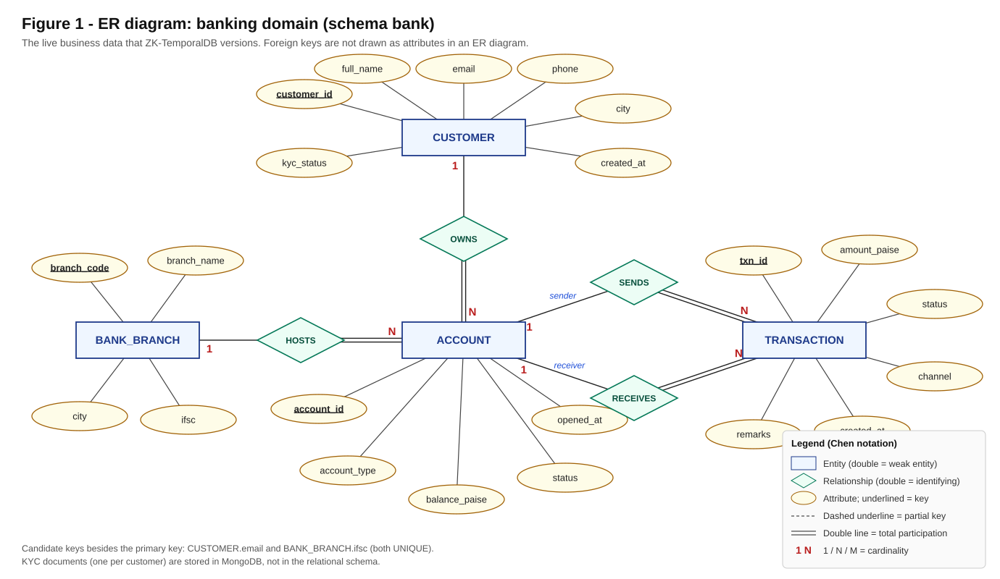
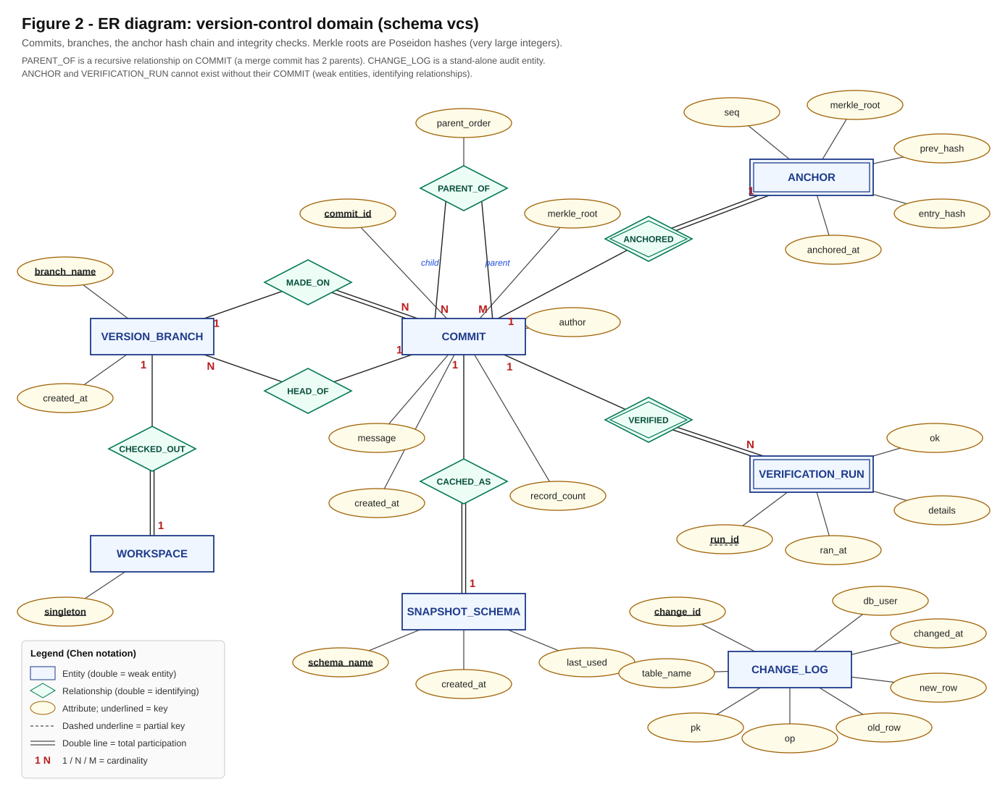

# ZK-TemporalDB: ER Model, ER-to-Relational Mapping, Normalisation and Schema

This document covers the **relational (PostgreSQL) part** of ZK-TemporalDB:

1. the **ER diagrams** (Chen notation),
2. the conversion of the ER model to a relational schema using the **standard 7-step mapping algorithm**,
3. the **normalisation** of the schema through **1NF → 2NF → 3NF** (and a BCNF check),
4. the **final relational schema**, with data types and constraints,
5. a summary of the **MongoDB** and **Neo4j** parts, for completeness.

The PostgreSQL database has two schemas:

| Schema | Purpose |
|---|---|
| `bank` | The live business data of the demo bank: branches, customers, accounts, transactions. **This is the data being versioned.** |
| `vcs` | The version-control system's own records: commits, parent links, branches, the anchor hash chain, the change log and verification runs. |

Source DDL: [`db/postgres/01_bank_schema.sql`](../db/postgres/01_bank_schema.sql), [`02_vcs_schema.sql`](../db/postgres/02_vcs_schema.sql), [`03_roles.sql`](../db/postgres/03_roles.sql).

---

## 1. ER diagrams

### Figure 1: Banking domain (`bank`)


### Figure 2: Version-control domain (`vcs`)


> Both images are SVG and can be inserted directly into the report. Open them in a browser and use *Print → Save as PDF*, or take a screenshot, if a PNG/PDF is needed.

### 1.1 Entity types

| Entity | Type | Key attribute(s) | Other attributes |
|---|---|---|---|
| BANK_BRANCH | strong | `branch_code` (candidate key: `ifsc`) | branch_name, city, ifsc |
| CUSTOMER | strong | `customer_id` (candidate key: `email`) | full_name, email, phone, city, kyc_status, created_at |
| ACCOUNT | strong | `account_id` | account_type, balance_paise, status, opened_at |
| TRANSACTION | strong | `txn_id` | amount_paise, status, channel, created_at, remarks |
| COMMIT | strong | `commit_id` | merkle_root, message, author, record_count, created_at |
| VERSION_BRANCH | strong | `branch_name` | created_at |
| WORKSPACE | strong (exactly one instance) | `singleton` | (none) |
| SNAPSHOT_SCHEMA | strong | `schema_name` | created_at, last_used |
| CHANGE_LOG | strong (stand-alone) | `change_id` | table_name, pk, op, old_row, new_row, changed_at, db_user |
| ANCHOR | **weak** (owner: COMMIT) | identified by its owner (1:1) | seq, merkle_root, prev_hash, entry_hash, anchored_at |
| VERIFICATION_RUN | **weak** (owner: COMMIT) | partial key `run_id` | ok, details, ran_at |

### 1.2 Relationship types

| Relationship | Between | Cardinality | Participation | Meaning |
|---|---|---|---|---|
| HOSTS | BANK_BRANCH – ACCOUNT | 1 : N | ACCOUNT total | every account is opened at one branch |
| OWNS | CUSTOMER – ACCOUNT | 1 : N | ACCOUNT total | every account belongs to one customer |
| SENDS | ACCOUNT (sender) – TRANSACTION | 1 : N | TRANSACTION total | the account money leaves |
| RECEIVES | ACCOUNT (receiver) – TRANSACTION | 1 : N | TRANSACTION total | the account money arrives at |
| MADE_ON | VERSION_BRANCH – COMMIT | 1 : N | COMMIT total | the branch a commit was made on |
| HEAD_OF | VERSION_BRANCH – COMMIT | N : 1 | both partial | a branch points at its latest commit (empty for a brand-new branch) |
| CHECKED_OUT | WORKSPACE – VERSION_BRANCH | 1 : 1 | WORKSPACE total | the branch currently loaded into the live tables |
| PARENT_OF | COMMIT (child) – COMMIT (parent) | M : N, **recursive** | partial | commit history; a merge commit has two parents. Attribute: `parent_order` |
| ANCHORED | COMMIT – ANCHOR | 1 : 1, **identifying** | ANCHOR total | each commit's root is recorded once in the hash chain |
| VERIFIED | COMMIT – VERIFICATION_RUN | 1 : N, **identifying** | VERIFICATION_RUN total | integrity checks performed on a commit |
| CACHED_AS | COMMIT – SNAPSHOT_SCHEMA | 1 : 1 | SNAPSHOT_SCHEMA total | a commit materialised as a schema for the SQL console |

---

## 2. ER-to-relational mapping: the 7-step algorithm

Notation: **`bold`** = primary key; `FK → T(c)` = foreign key referencing table T, column c.

### Step 1: Map regular (strong) entity types
*Rule:* for each strong entity E, create a relation R containing all simple attributes of E. Choose one key attribute as R's primary key.

| Entity | Relation produced |
|---|---|
| BANK_BRANCH | `bank_branches(`**`branch_code`**`, branch_name, city, ifsc)`; `ifsc` is UNIQUE (alternate key) |
| CUSTOMER | `customers(`**`customer_id`**`, full_name, email, phone, city, kyc_status, created_at)`; `email` is UNIQUE |
| ACCOUNT | `accounts(`**`account_id`**`, account_type, balance_paise, status, opened_at)` |
| TRANSACTION | `transactions(`**`txn_id`**`, amount_paise, status, channel, created_at, remarks)` |
| COMMIT | `commits(`**`commit_id`**`, merkle_root, message, author, record_count, created_at)` |
| VERSION_BRANCH | `branches(`**`branch_name`**`, created_at)` |
| WORKSPACE | `head(`**`singleton`**`)`, a single-row table: `CHECK (singleton)` allows only the value TRUE |
| SNAPSHOT_SCHEMA | `snapshot_schemas(`**`schema_name`**`, created_at, last_used)` (re-keyed in step 3) |
| CHANGE_LOG | `change_log(`**`change_id`**`, table_name, pk, op, old_row, new_row, changed_at, db_user)` |

Foreign keys are added in steps 3–5.

### Step 2: Map weak entity types
*Rule:* for each weak entity W with owner E, create a relation with W's attributes plus E's primary key as a foreign key. The primary key is (owner key + W's partial key).

| Weak entity | Relation produced | Notes |
|---|---|---|
| ANCHOR (owner COMMIT, 1:1) | `anchors(`**`commit_id`** `FK → commits, seq, merkle_root, prev_hash, entry_hash, anchored_at)` | With a 1:1 identifying relationship the owner key alone identifies the anchor, so no partial key is needed. **Implementation:** `seq` (BIGSERIAL) is used as the surrogate primary key, because the hash chain is ordered by it. `commit_id` is declared `NOT NULL UNIQUE`, so it remains a candidate key. |
| VERIFICATION_RUN (owner COMMIT) | `verification_runs(`**`commit_id`** `FK → commits,` **`run_id`**`, ok, details, ran_at)` | Mapped key = (commit_id, run_id). **Implementation:** `run_id` is a BIGSERIAL that is unique on its own, so it is the primary key, and `commit_id` is a `NOT NULL` foreign key. |

### Step 3: Map binary 1:1 relationship types
*Rule (foreign-key approach):* put the primary key of one side as a foreign key in the relation on the other side, preferably the side with **total** participation.

| Relationship | Result |
|---|---|
| CHECKED_OUT (WORKSPACE 1:1 VERSION_BRANCH, WORKSPACE total) | `head(`**`singleton`**`, branch_name FK → branches(branch_name) NOT NULL)` |
| CACHED_AS (COMMIT 1:1 SNAPSHOT_SCHEMA, SNAPSHOT_SCHEMA total) | `snapshot_schemas(`**`commit_id`** `FK → commits, schema_name UNIQUE, created_at, last_used)`. Because participation is total and the relationship is 1:1, the foreign key also serves as the primary key, and `schema_name` stays a candidate key. |
| ANCHORED | already handled in step 2 (identifying relationship of a weak entity) |

### Step 4: Map binary 1:N relationship types
*Rule:* put the primary key of the "1" side as a foreign key in the relation on the "N" side. Total participation of the N side gives `NOT NULL`.

| Relationship | Foreign key added to the N side |
|---|---|
| HOSTS (BANK_BRANCH 1:N ACCOUNT) | `accounts.branch_code FK → bank_branches(branch_code) NOT NULL` |
| OWNS (CUSTOMER 1:N ACCOUNT) | `accounts.customer_id FK → customers(customer_id) NOT NULL` |
| SENDS (ACCOUNT 1:N TRANSACTION) | `transactions.from_account FK → accounts(account_id) NOT NULL` |
| RECEIVES (ACCOUNT 1:N TRANSACTION) | `transactions.to_account FK → accounts(account_id) NOT NULL` (two foreign keys to the same table, distinguished by role) + `CHECK (from_account <> to_account)` |
| MADE_ON (VERSION_BRANCH 1:N COMMIT) | `commits.branch_name FK → branches(branch_name) NOT NULL` |
| HEAD_OF (VERSION_BRANCH N:1 COMMIT) | `branches.head_commit FK → commits(commit_id)`, **nullable** (partial participation: a new branch has no commit yet) |
| VERIFIED | already handled in step 2 |

### Step 5: Map binary M:N relationship types
*Rule:* create a new relation whose attributes are the primary keys of both participants (as foreign keys) plus the relationship's own attributes. The primary key is usually the combination of the foreign keys.

| Relationship | Relation produced |
|---|---|
| PARENT_OF (recursive COMMIT M:N COMMIT, attribute `parent_order`) | `commit_parents(`**`commit_id`** `FK → commits,` **`parent_order`**`, parent_id FK → commits)` |

Design notes:
- Both foreign keys reference the **same** table (`commits`): one for the *child* role, one for the *parent* role.
- The primary key is `(commit_id, parent_order)` rather than `(commit_id, parent_id)`, because the order matters (parent 1 = the branch merged into, parent 2 = the branch merged from). `CHECK (parent_order IN (1, 2))` limits a commit to at most two parents, and `CHECK (commit_id <> parent_id)` forbids a commit being its own parent.

### Step 6: Map multivalued attributes
*Rule:* for each multivalued attribute A of entity E, create a relation with A plus E's primary key. The primary key is the combination.

**There are no multivalued attributes in the final ER model.** Two candidates were considered:
- *A commit's list of parents* could have been modelled as a multivalued attribute `parents{}`. Each parent is itself a COMMIT, so it was modelled as the recursive relationship PARENT_OF instead (step 5). It produces the same kind of relation, `commit_parents`.
- *A customer's KYC document* (with a nested address) is semi-structured and lives in **MongoDB**, outside the relational schema (see section 6).

The JSONB columns `change_log.old_row/new_row` and `verification_runs.details` store complete, read-only snapshots as single values. They are never queried or updated element by element, so they are treated as atomic values (see the 1NF discussion in section 4).

### Step 7: Map N-ary relationship types (degree > 2)
*Rule:* create a relation with the primary keys of all participating entities plus the relationship's attributes.

**There are no N-ary relationships.** All relationships are binary (including the recursive PARENT_OF). A money transfer could be seen as a ternary relationship between a sender account, a receiver account and a "payment". Instead it is modelled as an **entity** (TRANSACTION) with two 1:N relationships. A transfer has its own identity (`txn_id`), its own attributes and its own life cycle (PENDING → COMPLETED / FAILED → REVERSED, enforced by a trigger), so an entity is the better choice. This is known as *reifying* the relationship.

### Result of the mapping
| # | Relation | Produced in step(s) |
|---|---|---|
| 1 | bank_branches | 1 |
| 2 | customers | 1 |
| 3 | accounts | 1, 4 |
| 4 | transactions | 1, 4 |
| 5 | commits | 1, 4 |
| 6 | branches | 1, 4 |
| 7 | head | 1, 3 |
| 8 | commit_parents | 5 |
| 9 | anchors | 2 |
| 10 | verification_runs | 2 |
| 11 | snapshot_schemas | 1, 3 |
| 12 | change_log | 1 |

---

## 3. Final relational schema

### 3.1 Schema diagram (relations, keys and references)

```mermaid
erDiagram
    BANK_BRANCHES ||--o{ ACCOUNTS : "branch_code"
    CUSTOMERS     ||--o{ ACCOUNTS : "customer_id"
    ACCOUNTS      ||--o{ TRANSACTIONS : "from_account"
    ACCOUNTS      ||--o{ TRANSACTIONS : "to_account"
    BRANCHES      ||--o{ COMMITS : "branch_name"
    COMMITS       |o--o{ BRANCHES : "head_commit"
    BRANCHES      ||--|| HEAD : "branch_name"
    COMMITS       ||--o{ COMMIT_PARENTS : "commit_id (child)"
    COMMITS       ||--o{ COMMIT_PARENTS : "parent_id (parent)"
    COMMITS       ||--|| ANCHORS : "commit_id"
    COMMITS       ||--o{ VERIFICATION_RUNS : "commit_id"
    COMMITS       ||--o| SNAPSHOT_SCHEMAS : "commit_id"

    BANK_BRANCHES { char6 branch_code PK
                    varchar branch_name
                    varchar city
                    char11 ifsc UK }
    CUSTOMERS { int customer_id PK
                varchar full_name
                varchar email UK
                varchar phone
                varchar city
                varchar kyc_status
                date created_at }
    ACCOUNTS { bigint account_id PK
               int customer_id FK
               char6 branch_code FK
               varchar account_type
               bigint balance_paise
               varchar status
               date opened_at }
    TRANSACTIONS { bigint txn_id PK
                   bigint from_account FK
                   bigint to_account FK
                   bigint amount_paise
                   varchar status
                   varchar channel
                   timestamptz created_at
                   varchar remarks }
    COMMITS { char16 commit_id PK
              varchar branch_name FK
              numeric merkle_root
              varchar message
              varchar author
              int record_count
              timestamptz created_at }
    COMMIT_PARENTS { char16 commit_id PK,FK
                     smallint parent_order PK
                     char16 parent_id FK }
    BRANCHES { varchar branch_name PK
               char16 head_commit FK
               timestamptz created_at }
    HEAD { boolean singleton PK
           varchar branch_name FK }
    ANCHORS { bigserial seq PK
              char16 commit_id UK,FK
              numeric merkle_root
              char64 prev_hash
              char64 entry_hash UK
              timestamptz anchored_at }
    VERIFICATION_RUNS { bigserial run_id PK
                        char16 commit_id FK
                        boolean ok
                        jsonb details
                        timestamptz ran_at }
    SNAPSHOT_SCHEMAS { char16 commit_id PK,FK
                       text schema_name UK
                       timestamptz created_at
                       timestamptz last_used }
    CHANGE_LOG { bigserial change_id PK
                 varchar table_name
                 text pk
                 char1 op
                 jsonb old_row
                 jsonb new_row
                 timestamptz changed_at
                 text db_user }
```

### 3.2 Relations with data types and constraints

**Schema `bank`**

```
bank_branches ( branch_code  CHAR(6)       PRIMARY KEY,
                branch_name  VARCHAR(80)   NOT NULL,
                city         VARCHAR(40)   NOT NULL,
                ifsc         CHAR(11)      NOT NULL UNIQUE )

customers     ( customer_id  INTEGER       PRIMARY KEY,
                full_name    VARCHAR(80)   NOT NULL,
                email        VARCHAR(120)  NOT NULL UNIQUE,
                phone        VARCHAR(15)   NOT NULL,
                city         VARCHAR(40)   NOT NULL,
                kyc_status   VARCHAR(10)   NOT NULL DEFAULT 'PENDING'
                             CHECK (kyc_status IN ('PENDING','VERIFIED','REJECTED')),
                created_at   DATE          NOT NULL DEFAULT CURRENT_DATE )

accounts      ( account_id    BIGINT       PRIMARY KEY,
                customer_id   INTEGER      NOT NULL  REFERENCES customers(customer_id),
                branch_code   CHAR(6)      NOT NULL  REFERENCES bank_branches(branch_code),
                account_type  VARCHAR(10)  NOT NULL  CHECK (account_type IN ('SAVINGS','CURRENT')),
                balance_paise BIGINT       NOT NULL  DEFAULT 0  CHECK (balance_paise >= 0),
                status        VARCHAR(8)   NOT NULL  DEFAULT 'ACTIVE'
                              CHECK (status IN ('ACTIVE','FROZEN','CLOSED')),
                opened_at     DATE         NOT NULL  DEFAULT CURRENT_DATE )

transactions  ( txn_id        BIGINT       PRIMARY KEY,
                from_account  BIGINT       NOT NULL  REFERENCES accounts(account_id),
                to_account    BIGINT       NOT NULL  REFERENCES accounts(account_id),
                amount_paise  BIGINT       NOT NULL  CHECK (amount_paise > 0),
                status        VARCHAR(9)   NOT NULL  DEFAULT 'PENDING'
                              CHECK (status IN ('PENDING','COMPLETED','FAILED','REVERSED')),
                channel       VARCHAR(4)   NOT NULL  CHECK (channel IN ('UPI','NEFT','IMPS','CARD')),
                created_at    TIMESTAMPTZ  NOT NULL  DEFAULT now(),
                remarks       VARCHAR(120),
                CHECK (from_account <> to_account) )
```

**Schema `vcs`**

```
commits           ( commit_id     CHAR(16)      PRIMARY KEY,
                    branch_name   VARCHAR(40)   NOT NULL  REFERENCES branches(branch_name),
                    merkle_root   NUMERIC(80)   NOT NULL,
                    message       VARCHAR(200)  NOT NULL,
                    author        VARCHAR(60)   NOT NULL,
                    record_count  INTEGER       NOT NULL  CHECK (record_count >= 0),
                    created_at    TIMESTAMPTZ   NOT NULL )

commit_parents    ( commit_id     CHAR(16)  NOT NULL REFERENCES commits(commit_id),
                    parent_id     CHAR(16)  NOT NULL REFERENCES commits(commit_id),
                    parent_order  SMALLINT  NOT NULL CHECK (parent_order IN (1,2)),
                    PRIMARY KEY (commit_id, parent_order),
                    CHECK (commit_id <> parent_id) )

branches          ( branch_name   VARCHAR(40)  PRIMARY KEY  CHECK (branch_name ~ '^[a-z0-9][a-z0-9._/-]*$'),
                    head_commit   CHAR(16)     REFERENCES commits(commit_id),
                    created_at    TIMESTAMPTZ  NOT NULL )

head              ( singleton     BOOLEAN      PRIMARY KEY DEFAULT TRUE CHECK (singleton),
                    branch_name   VARCHAR(40)  NOT NULL REFERENCES branches(branch_name) )

anchors           ( seq           BIGSERIAL    PRIMARY KEY,
                    commit_id     CHAR(16)     NOT NULL UNIQUE REFERENCES commits(commit_id),
                    merkle_root   NUMERIC(80)  NOT NULL,
                    prev_hash     CHAR(64)     NOT NULL,
                    entry_hash    CHAR(64)     NOT NULL UNIQUE,
                    anchored_at   TIMESTAMPTZ  NOT NULL )

verification_runs ( run_id        BIGSERIAL    PRIMARY KEY,
                    commit_id     CHAR(16)     NOT NULL REFERENCES commits(commit_id),
                    ok            BOOLEAN      NOT NULL,
                    details       JSONB        NOT NULL,
                    ran_at        TIMESTAMPTZ  NOT NULL )

snapshot_schemas  ( commit_id     CHAR(16)     PRIMARY KEY REFERENCES commits(commit_id),
                    schema_name   TEXT         NOT NULL UNIQUE,
                    created_at    TIMESTAMPTZ  NOT NULL,
                    last_used     TIMESTAMPTZ  NOT NULL )

change_log        ( change_id     BIGSERIAL    PRIMARY KEY,
                    table_name    VARCHAR(40)  NOT NULL,
                    pk            TEXT         NOT NULL,
                    op            CHAR(1)      NOT NULL CHECK (op IN ('I','U','D')),
                    old_row       JSONB,
                    new_row       JSONB,
                    changed_at    TIMESTAMPTZ  NOT NULL,
                    db_user       TEXT         NOT NULL )
```

`change_log` has no foreign key on purpose: `(table_name, pk)` can point to a row in **any** bank table, including rows that were later deleted.

### 3.3 Other schema objects
| Object | Kind | Purpose |
|---|---|---|
| `idx_accounts_customer`, `idx_txn_from`, `idx_txn_to`, `idx_txn_status`, `idx_parents_parent`, `idx_change_log_key` | indexes | speed up joins on foreign keys and status filters |
| `bank.txn_id_seq` | sequence | new transaction ids (starts at 100001) |
| `trg_txn_state_machine` | trigger | allows only PENDING→COMPLETED/FAILED and COMPLETED→REVERSED |
| `trg_audit_*` → `vcs.fn_audit_row` | triggers | write every row change into `change_log` |
| `trg_commits_immutable`, `trg_parents_immutable`, `trg_anchors_immutable` | triggers | forbid UPDATE/DELETE: history is append-only |
| `trg_anchor_chain` | trigger | computes `prev_hash` and `entry_hash` (SHA-256 chain) |
| `bank.sp_transfer`, `sp_settle_txn`, `sp_reverse_txn` | stored functions | the only way money moves (atomic, with row locks) |
| `vcs.sp_record_commit` | stored procedure | inserts commit + parents + anchor and moves the branch, in one transaction |
| `vcs.fn_ancestors`, `vcs.fn_merge_base` | functions (recursive CTEs) | commit history, and the merge base of two branches |
| `vcs.fn_verify_anchor_chain` | function (window function `LAG`) | re-checks every link of the hash chain |
| `bank.v_account_summary`, `vcs.v_commit_log` | views | reporting |
| `ztdb_reader` | role | read-only user for the time-travel SQL console |

---

## 4. Normalisation: 1NF → 2NF → 3NF (→ BCNF)

We start from what a naive banking application might keep: one **bank statement** per customer, with everything in one place.

### 4.0 Unnormalised form (UNF)

```
CUSTOMER_STATEMENT ( customer_id, full_name, email, phone, cust_city, kyc_status, cust_created_at,
                     { account_id, account_type, balance_paise, acc_status, opened_at,
                       branch_code, branch_name, branch_city, ifsc,
                       { txn_id, from_account, to_account, amount_paise, txn_status,
                         channel, txn_created_at, remarks } } )
```
`{ … }` marks a **repeating group**: a customer has many accounts, and each account has many transactions. This violates 1NF (a cell would have to hold a list of values).

### 4.1 First Normal Form (1NF)
**Rule:** every attribute holds a single atomic value; there are no repeating groups; every row is unique (there is a primary key).

We flatten the repeating groups. A transaction appears on the statements of **both** of its accounts, so each row is "one transaction line on one account's statement":

```
BANK_1NF ( txn_id, account_id,                                   ← primary key = {txn_id, account_id}
           from_account, to_account, amount_paise, txn_status, channel, txn_created_at, remarks,
           account_type, balance_paise, acc_status, opened_at,
           customer_id, full_name, email, phone, cust_city, kyc_status, cust_created_at,
           branch_code, branch_name, branch_city, ifsc )
```
Sample rows (real data from the demo database):

| txn_id | account_id | amount_paise | txn_status | from_account | to_account | customer_id | full_name | branch_code | branch_name | … |
|---|---|---|---|---|---|---|---|---|---|---|
| 100600 | 5001000001 | 25000000 | COMPLETED | 5001000001 | 5001000054 | 1 | Ananya Rao | MUM001 | ZTDB Fort | … |
| 100600 | 5001000054 | 25000000 | COMPLETED | 5001000001 | 5001000054 | 41 | Vikram Rao Builders | BLR001 | ZTDB MG Road | … |
| 100549 | 5001000001 | 2812300 | COMPLETED | 5001000024 | 5001000001 | 1 | Ananya Rao | MUM001 | ZTDB Fort | … |
| 100549 | 5001000024 | 2812300 | COMPLETED | 5001000024 | 5001000001 | 18 | Varun Gupta | BLR001 | ZTDB MG Road | … |

This is in 1NF, but has severe **anomalies**:
- **Update anomaly:** renaming branch MUM001 means updating *every transaction line* of *every account* at that branch. Miss one, and the data contradicts itself.
- **Insertion anomaly:** a new branch, or a new customer with no transactions yet, cannot be stored, because `txn_id` is part of the primary key and cannot be NULL.
- **Deletion anomaly:** deleting a customer's only transaction also loses the customer, the account and possibly the branch.
- **Redundancy:** every transaction's details are stored twice (once per account), and customer and branch details on every line.

**Functional dependencies** in BANK_1NF:

| # | Functional dependency |
|---|---|
| FD1 | `txn_id → from_account, to_account, amount_paise, txn_status, channel, txn_created_at, remarks` |
| FD2 | `account_id → account_type, balance_paise, acc_status, opened_at, customer_id, branch_code` |
| FD3 | `customer_id → full_name, email, phone, cust_city, kyc_status, cust_created_at` |
| FD4 | `branch_code → branch_name, branch_city, ifsc` |
| FD5 | `email → customer_id` and `ifsc → branch_code` (alternate keys) |

### 4.2 Second Normal Form (2NF)
**Rule:** 1NF, and every non-key attribute depends on the **whole** primary key, with no **partial dependency** on part of a composite key.

The key is `{txn_id, account_id}`, but:
- the transaction attributes depend only on `txn_id` (FD1): a partial dependency;
- the account, customer and branch attributes depend only on `account_id` (FD2 → FD3, FD4): a partial dependency.

Decompose by FD1 and FD2:

```
TRANSACTION   ( txn_id, from_account, to_account, amount_paise, txn_status, channel, txn_created_at, remarks )
ACCOUNT_2NF   ( account_id, account_type, balance_paise, acc_status, opened_at,
                customer_id, full_name, email, phone, cust_city, kyc_status, cust_created_at,
                branch_code, branch_name, branch_city, ifsc )
STATEMENT_LINE( txn_id, account_id )
```
`STATEMENT_LINE` holds no information of its own: the accounts of a transaction are already `from_account` and `to_account`, so a statement line can always be rebuilt with a query (`WHERE account_id IN (from_account, to_account)`). It is therefore **dropped**. This also removes the duplicate storage of each transaction.

Each remaining relation has a single-attribute key, so no partial dependency can exist: **2NF ✓**.

### 4.3 Third Normal Form (3NF)
**Rule:** 2NF, and no **transitive dependency**: no non-key attribute depends on another non-key attribute.

`ACCOUNT_2NF` still has transitive dependencies:
- `account_id → customer_id → full_name, email, phone, cust_city, kyc_status, …` (via FD2, FD3)
- `account_id → branch_code → branch_name, branch_city, ifsc` (via FD2, FD4)

Decompose by FD3 and FD4:

```
ACCOUNT      ( account_id, customer_id, branch_code, account_type, balance_paise, acc_status, opened_at )
CUSTOMER     ( customer_id, full_name, email, phone, city, kyc_status, created_at )
BANK_BRANCH  ( branch_code, branch_name, city, ifsc )
TRANSACTION  ( txn_id, from_account, to_account, amount_paise, status, channel, created_at, remarks )
```
`customer_id` and `branch_code` stay in ACCOUNT as **foreign keys**; `from_account` and `to_account` in TRANSACTION are foreign keys to ACCOUNT. These are exactly the four tables of schema `bank`: **3NF ✓**.

All four anomalies are gone: a branch is renamed in one row; a branch or customer can exist without transactions; deleting a transaction deletes only that transaction; each fact is stored once.

The decomposition is **lossless**: every decomposition step split on a key (`txn_id`, `account_id`, `customer_id`, `branch_code`), so natural joins rebuild the original data exactly. It is also **dependency-preserving**: FD1–FD5 each fall entirely inside one final relation.

### 4.4 BCNF check
**Rule:** for every non-trivial FD `X → Y`, X is a superkey.

| Relation | Determinants | Superkeys? |
|---|---|---|
| bank_branches | `branch_code`, `ifsc` | both are candidate keys ✓ |
| customers | `customer_id`, `email` | both are candidate keys ✓ |
| accounts | `account_id` | primary key ✓ |
| transactions | `txn_id` | primary key ✓ |

The bank schema is in **BCNF**.

### 4.5 Normalisation of the version-control schema
Starting point: a single "commit log" relation.

```
COMMIT_LOG ( commit_id, message, author, created_at, merkle_root, record_count,
             branch_name, branch_head_commit,
             { parent_id },
             anchor_seq, prev_hash, entry_hash, anchored_at,
             { run_id, ok, details, ran_at } )
```
| Form | Problem | Fix |
|---|---|---|
| **1NF** | `{parent_id}` (a merge has two) and `{verification run}` are repeating groups | move parents to `commit_parents(commit_id, parent_order, parent_id)`; runs to `verification_runs(run_id, commit_id, ok, details, ran_at)` |
| **2NF** | in `commit_parents`, key = (commit_id, parent_order) and `parent_id` depends on the whole key ✓. Storing the parent's message there would be a partial dependency on `parent_id`, so it is not stored. | none needed |
| **3NF** | `commit_id → branch_name → branch_head_commit` is transitive (the head belongs to the branch, not to the commit) | move it to `branches(branch_name, head_commit)` |
| **3NF** | `commit_id → anchor_seq → prev_hash, entry_hash, anchored_at` | move it to `anchors(seq, commit_id, merkle_root, prev_hash, entry_hash, anchored_at)` |

Result: `commits`, `commit_parents`, `branches`, `anchors`, `verification_runs`, all in 3NF/BCNF.

### 4.6 Deliberate, controlled redundancy
Three values are derivable from other data but are stored on purpose:

| Stored value | Could be derived from | Why it is kept |
|---|---|---|
| `accounts.balance_paise` | the sum of the account's completed transactions | every core-banking system keeps a balance, for speed. It is changed only inside `sp_settle_txn` / `sp_reverse_txn`, in the same ACID transaction as the status change, so it cannot drift. |
| `anchors.merkle_root` | `commits.merkle_root` | **intentional duplicate for tamper evidence.** Both rows are immutable (triggers), and the anchor copy is protected by the hash chain, so if anyone forges `commits.merkle_root` the two copies disagree (Verify check 4). |
| `commits.record_count` | counting the commit's manifest entries in MongoDB | saves a cross-database read. Commits are immutable, so it can never become stale. |

Because these rows are either immutable or updated only atomically by stored procedures, the usual update anomalies of redundancy cannot occur.

**1NF note on JSONB columns:** `change_log.old_row/new_row` and `verification_runs.details` hold whole JSON documents. They are treated as atomic values: always written and read as a whole, never searched or updated element by element. They are an audit payload, not data the schema relies on.

---

## 5. Integrity constraints summary
| Kind | Examples |
|---|---|
| Entity integrity | every table has a PRIMARY KEY (NOT NULL + UNIQUE) |
| Referential integrity | 12 foreign keys (section 3.2); commits/parents/anchors can never be deleted, so references to them can never dangle |
| Domain integrity | `CHECK` lists for statuses, channels, account types, `op`; `balance_paise >= 0`; `amount_paise > 0`; branch-name format |
| Key constraints | alternate keys: `customers.email`, `bank_branches.ifsc`, `anchors.commit_id`, `anchors.entry_hash`, `snapshot_schemas.schema_name` |
| Semantic constraints (triggers) | transaction state machine, append-only history, hash-chained anchors |

---

## 6. Non-relational parts (for completeness)

**MongoDB**

| Database.collection | One document = | Key fields |
|---|---|---|
| `bank_live.kyc_documents` | one customer's KYC document (versioned with the SQL tables) | `_id` (KYC-0001…), customer_id, doc_type, doc_number_masked, verified, verified_by, address{city, pincode}, risk_score |
| `ztdb.blobs` | one version of one record, content-addressed | `_id` = SHA-256 of the canonical record, key, table, pk, fields[[name, value]…], salt |
| `ztdb.trees` | the manifest of one commit | `_id` = commit_id, root, created_at, entries[{key, blob, leaf}…] |
| `ztdb.proofs` | an issued zero-knowledge proof package | proof_id, commit_id, root, anchor, claim, proof, publicSignals |

**Neo4j**

```
(:Branch {name})-[:HEAD]->(:Commit {id, root, message, author, created_at, added, modified, deleted})
(:Commit)-[:PARENT]->(:Commit)
(:Record {key, table, pk})-[:HAS_VERSION]->(:Version {id = blob SHA-256})-[:INTRODUCED_IN {kind}]->(:Commit)
(:Version)-[:PREVIOUS]->(:Version)          (:Record)-[:DELETED_IN]->(:Commit)
(:Proof)-[:ABOUT]->(:Version)               (:Proof)-[:AGAINST]->(:Commit)
(:Account)-[:SENT {txn_id, amount, status, at}]->(:Account)      money-flow graph for fraud-ring detection
```
